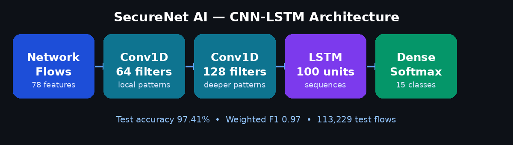

# 🛡️ SecureNet AI — Network Intrusion Detection System

A Flask web app that detects network attacks in real time using a **CNN-LSTM deep learning model** trained on the **CIC-IDS2017** dataset.


## 📊 Results

| Metric | Score |
|:---|:---:|
| **Test accuracy** | **97.41%** (113,229 test flows) |
| Weighted F1-score | 0.97 |
| Best validation accuracy | 97.41% |
| Final training accuracy | 97.17% |

Strong on the attacks that matter most — **BENIGN F1 0.98, DDoS F1 0.99, PortScan F1 0.91, DoS Hulk F1 0.99**. Rare classes with almost no samples in the data (Bot: 62 flows, Infiltration: 2, SQL Injection: 1) score near 0 — an honest data limitation, not a model bug. Macro-average F1 is 0.59 for the same reason.

## 🧠 Model




**CNN-LSTM, 15 attack classes** — Conv1D(64) → Dropout → Conv1D(128) → Dropout → LSTM(100) → Dense softmax. CNN layers learn local patterns in network flows; the LSTM learns the sequence. Trained with early stopping, learning-rate reduction and checkpointing (20 epochs max, GPU).

**Classes detected:** BENIGN, DDoS, PortScan, DoS Hulk, DoS GoldenEye, DoS slowloris, DoS Slowhttptest, FTP-Patator, SSH-Patator, Bot, Web Attack (Brute Force / XSS / SQL Injection), Infiltration, Heartbleed.

## ✨ Features

- 🔐 User signup and login (SQLite)
- 📈 Dashboard for traffic analysis and attack detection
- 🔍 Paste or upload network flow features → instant attack classification
- 📓 Full training notebook with accuracy curves and confusion matrix

## 🛠️ Tech Stack

Python 3.11 · Flask 3.1 · TensorFlow/Keras 2.18 · scikit-learn · imbalanced-learn (SMOTE) · pandas · NumPy · SQLite · HTML/CSS/JS

## 🚀 Setup

1. Clone the repo:
   ```
   git clone https://github.com/viju03-tech/SecureNet-AI.git
   cd SecureNet-AI
   ```
2. Install dependencies:
   ```
   pip install -r requirements.txt
   ```
3. Download the CIC-IDS2017 CSV files (search "CIC-IDS2017 UNB") and place them in a `dataset/` folder.
4. Run:
   ```
   python app.py
   ```
5. Open http://localhost:5000

## 📁 Project Structure

- `app.py` — Flask application
- `models/` — trained model, scaler and label encoder
- `templates/` — HTML pages
- `network-intrusion-detection-cic-ids-dataset.ipynb` — model training notebook (data prep, SMOTE, training, evaluation)

## 📦 Dataset

[CIC-IDS2017](https://www.unb.ca/cic/datasets/ids-2017.html) by the Canadian Institute for Cybersecurity. The raw CSVs are too large for GitHub, so download them separately (see Setup step 3).

## 👩‍💻 Author

**Viju B** — B.E. CSE, Sathyabama Institute of Science and Technology · [GitHub](https://github.com/viju03-tech) · [LinkedIn](https://www.linkedin.com/in/viju-b-4499823b4)
